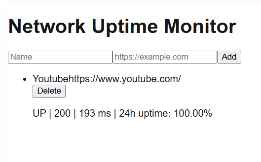

# Network Uptime Monitor

A small self-hosted dashboard that checks whether your websites and services are reachable, records response time, and shows 24-hour uptime at a glance.



## Features

- Add and remove monitors (name + HTTP/HTTPS URL)
- Automatic check every 60 seconds with a 5 second timeout
- Per-monitor status, HTTP status code, and latency
- 24-hour uptime percentage and a history bar of the latest 60 checks
- Dashboard refreshes itself every 30 seconds
- Old check history is cleaned up automatically (7 days)

## Tech Stack

- Next.js (App Router) and TypeScript
- Tailwind CSS
- Prisma 7 with the MariaDB driver adapter
- MySQL / MariaDB

## Getting Started

Requirements: Node.js 20+ and a running MySQL or MariaDB server.

```bash
git clone https://github.com/USERNAME/uptime-monitor.git
cd uptime-monitor
npm install
```

Create a `.env` file:

```
DATABASE_URL="mysql://root@localhost:3306/uptime_monitor"
```

Create the database, run the migration, and start the app:

```bash
mysql -u root -e "CREATE DATABASE uptime_monitor"
npx prisma migrate dev
npx prisma generate
npm run dev
```

Open http://localhost:3000.

## Tests

```bash
npx tsx --test test/probe.test.ts
```

The test starts a local HTTP server and verifies the probe against a healthy response, a 500 response, and a closed port.

## Project Structure

```
prisma/schema.prisma      Monitor and Check models
src/instrumentation.ts    Starts the 60 second check loop on server start
src/lib/probe.ts          Single HTTP check (status, latency, timeout)
src/lib/check.ts          Runs all monitors, stores results, prunes old data
src/lib/db.ts             Prisma client with MariaDB adapter
src/app/actions.ts        Server actions: add and remove monitor
src/app/page.tsx          Dashboard
src/app/refresher.tsx     Client-side auto refresh
test/probe.test.ts        Probe test
```

## How It Works

On server start, `instrumentation.ts` runs `runChecks()` immediately and then every 60 seconds. Each run probes every monitor in parallel, writes one `Check` row per monitor, and deletes rows older than 7 days. The dashboard is a server component that reads the last 24 hours of checks and calculates uptime from them.

## Limitations

- The checker relies on a long-running Node process, so it fits a VPS, Railway, Render, or local use. On Vercel serverless it needs a cron-triggered endpoint instead.
- There is no authentication. Do not expose it publicly as is, because the server fetches whatever URL is added.
- HTTP/HTTPS checks only. TCP and ICMP checks are not implemented.